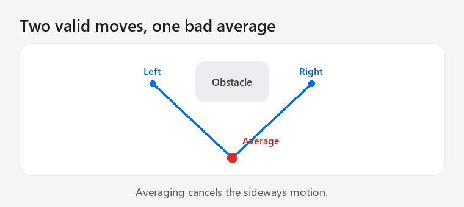

# Diffusion policies for obstacle avoidance

[All projects](README.md) · [Robot Learning essay](https://jason-wang313.github.io/blog/robot-learning.html) · [Policy code](so100_policy.py) · [Evaluator](evaluate_so100.py)

When left and right are both valid, what does a policy do with demonstrations of both routes? Compare a single-output MSE policy and a conditional diffusion policy on the same data.


*Illustration of left and right moves averaging toward an obstacle.*

## Record one shared dataset

Collect both left and right approaches to the **same** obstacle configurations using the same teleoperation workflow. Convert those demonstrations to one processed store and use it for both policies. Use the [SO100 setup and training command](so100-recovery.md#train-a-baseline) with that store. Run it once with `--policy obstacle` for the MSE baseline and once with `--policy diffusion`. Keep the same seed, feature list, action representation, and eight-step horizon. Preserve both checkpoint files.

## Evaluate both policies

Run from the installed HW3 environment:

```sh
python /path/to/projects/evaluate_so100.py checkpoints/mse.pt checkpoints/diffusion.pt --seed 5042 --output avoidance.json
```

The evaluator uses the same seeded layout sequence for both checkpoints.

## Read the rollouts

The JSON records rollout-level success, contact, and a coarse left/right/central proxy measured near the obstacle, plus complete gripper trajectories. Inspect the trajectories, especially centrally classified and failed runs. For a multimodality follow-up, pass `--repeat-layout` to reset the same layout with a different Torch seed on each episode and compare successful routes. Across-layout route counts alone cannot establish bimodality at a fixed observation. The policy uses deterministic DDIM per initial noise draw and fresh noise for each action chunk.
