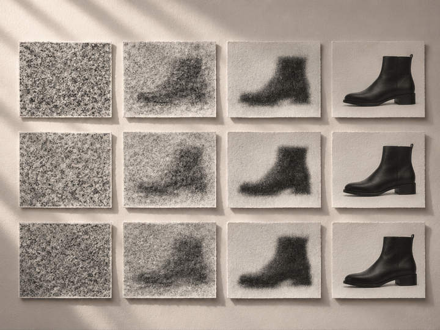

# Image generation with DDPM

[All projects](README.md) · [Diffusion essay](https://jason-wang313.github.io/blog/cme296.html) · [Training and sampling script](fashion_ddpm.py) · [Shared DDIM implementation](diffusion.py)

What do extra denoising steps buy? Train one small model and compare the same starting noise at 10, 25, and 50 DDIM steps.


*Illustration of a boot emerging from noise in stages.*

## Train one checkpoint and sample at three budgets

Install compatible PyTorch and torchvision builds for your platform. The training command downloads Fashion-MNIST the first time.

```sh
python fashion_ddpm.py train --output runs/fashion --device cpu
python fashion_ddpm.py compare --output runs/fashion --checkpoint runs/fashion/denoiser.pt --device cpu
```

## Compare the grid and timings

The default is a compact 28 × 28 denoiser trained on a seeded 6,000-image subset. The comparison uses one checkpoint and the same batch of initial noise for 10, 25, and 50 DDIM steps. It writes a matched image grid and median inference time over three repeats per budget. Inspect image quality from the grid. The script does not produce a quantitative quality score. Use `--limit 0` for the full dataset or `--device cuda` if a GPU is available later.

| Output | Contents |
| --- | --- |
| `denoiser.pt` | Trained model weights |
| `ddim-10-25-50.png` | Three rows of samples. Each column starts from the same initial noise. |
| `timings.json` | Median batch time from three repeats at each step count |
