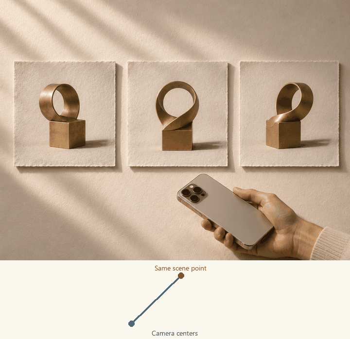

# 3D reconstruction from handheld video

[All projects](README.md) · [3D Vision essay](https://jason-wang313.github.io/blog/3d-vision.html) · [Reconstruction script](reconstruct.py)

How does the spacing between frames change what you can reconstruct from one phone clip? Compare camera registration and scene coverage before judging the point cloud by its reprojection error.


*Illustration of camera motion creating a second viewpoint.*

## Capture a clip and run the comparison

Install COLMAP and `opencv-python`. Use a short video with visible texture, sideways camera motion, and overlap between views. Then run:

```sh
python reconstruct.py phone.mp4 runs/desk --strides 5 10 20 --max-frames 40
```

The pipeline extracts and downsizes frames, runs CPU feature extraction and sequential matching, then registers cameras with COLMAP’s sparse mapper.

## Inspect the reconstruction

| Output | What to check |
| --- | --- |
| `summary.json` | Input frames, registered cameras, point count, and mean reprojection error across strides |
| `stride-*/points.ply` | Where the best-registered reconstruction has coverage |
| `stride-*/sparse/` | Native COLMAP models, including camera poses |

Use a new output directory for each comparison. Trim the source clip to a duration covered by all three stride settings. Check how many frames registered before interpreting reprojection error. A run can show a low average by dropping the harder views.
